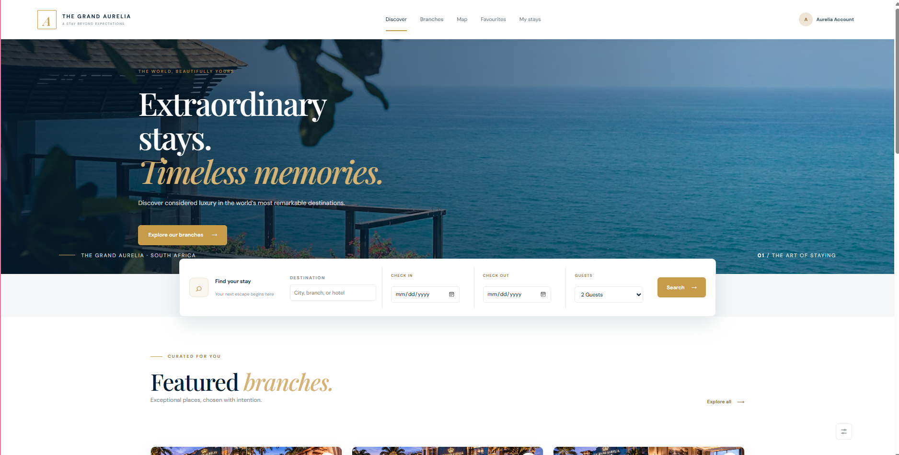
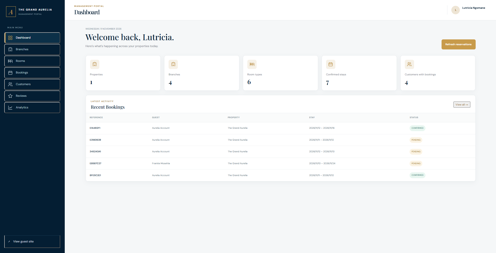
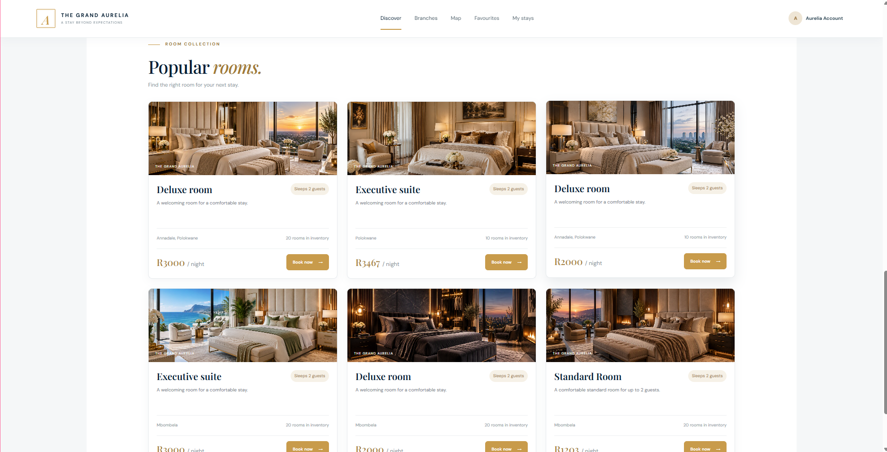
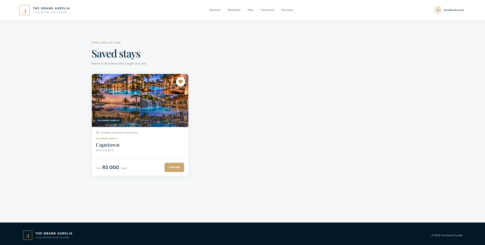

# The Grand Aurelia — Hotel Booking Platform

A luxury hotel booking platform built to manage hotel properties, accommodation branches, room availability, reservations, payments, and guest accounts.

## Overview

The Grand Aurelia provides guests with a platform to discover accommodation, explore hotel branches, make reservations, manage bookings, and save favourite properties.

The platform also includes administrative functionality for managing accommodation and reservations.

## Preview 

### Landing


### Admin


### Rooms


### Favs

## Technology Stack

### Frontend
- React
- TypeScript
- Vite
- Redux Toolkit
- CSS

### Backend
- Node.js
- Express.js
- TypeScript
- Prisma ORM
- PostgreSQL
- Multer

### Integrations
- Google OAuth authentication
- Paystack payment integration
- Neon PostgreSQL database

### Hosting
- Frontend: Vercel
- Backend: Render
- Database: Neon

## Features

### Guest features
- Browse hotel properties and accommodation branches
- Explore rooms and room options
- View accommodation photographs
- Create an account and sign in
- Google authentication
- Make reservations
- Complete payments through Paystack
- View and manage bookings
- Save and manage favourite accommodation
- View and submit hotel reviews
- Manage personal profile information
- Search accommodation

### Administration
- Manage accommodation branches
- Manage rooms and room options
- View and manage reservations
- Manage users

## Project Structure

```text
hotel-booking-app/
│
├── client/
│   ├── src/
│   │   ├── components/
│   │   ├── layouts/
│   │   ├── pages/
│   │   ├── store/
│   │   ├── types/
│   │   ├── utils/
│   │   ├── App.tsx
│   │   └── api.ts
│   └── package.json
│
├── server/
│   ├── prisma/
│   │   ├── migrations/
│   │   └── schema.prisma
│   ├── src/
│   │   ├── routes/
│   │   ├── middleware/
│   │   ├── lib/
│   │   ├── app.ts
│   │   └── server.ts
│   └── package.json
│
└── README.md
```

## Installation

### Requirements
- Node.js
- npm
- PostgreSQL database
- Git

### 1. Clone the repository

```bash
git clone YOUR_REPOSITORY_URL
cd hotel-booking-app
```

### 2. Install frontend dependencies

```bash
cd client
npm install
```

### 3. Install backend dependencies

```bash
cd ../server
npm install
```

## Environment Variables

Configure the required environment variables in your local environment and hosting dashboards.

### Frontend — `client/.env`

```env
VITE_API_URL=http://localhost:3000/api/v1
```

For production:

```env
VITE_API_URL=https://hotelapp-thegrandaurelia.onrender.com/api/v1
```

### Backend — `server/.env`

For local development, configure the following variables with your own credentials:

```env
DATABASE_URL=YOUR_NEON_DATABASE_URL
GOOGLE_CLIENT_ID=YOUR_GOOGLE_CLIENT_ID
GOOGLE_CLIENT_SECRET=YOUR_GOOGLE_CLIENT_SECRET
GOOGLE_CALLBACK_URL=http://localhost:3000/api/v1/auth/google/callback
FRONTEND_URL=http://localhost:5173
```

Also configure the payment, authentication, and other environment variables required by the backend.

For the Render production environment, set `FRONTEND_URL` to the deployed frontend URL:

```env
FRONTEND_URL=https://hotelapp-the-grand-aurelia.vercel.app
GOOGLE_CALLBACK_URL=https://hotelapp-thegrandaurelia.onrender.com/api/v1/auth/google/callback
```

Paystack uses this value as its payment return URL. If it is set to `http://localhost:5173` in Render, customers will be redirected to localhost after paying.

**Security:** Never commit `.env` files, database credentials, OAuth secrets, or payment secret keys to GitHub.

## Running Locally

### Start the backend

```bash
cd server
npm run dev
```

### Start the frontend

Open a second terminal:

```bash
cd client
npm run dev
```

The frontend runs on the Vite development server, normally at:

`http://localhost:5173`

The backend runs on its configured local port, normally `3000`.

## Production Deployment

### Frontend — Vercel

- Root directory: `client`
- Framework: Vite
- Build command: `npm run build`
- Output directory: `dist`
- Environment variable: `VITE_API_URL`

### Backend — Render

- Root directory: `server`
- Build command: Use the configured Prisma generation and TypeScript build commands.
- Start command: `npm start`

The backend connects to the Neon PostgreSQL database through `DATABASE_URL`.
In Google Cloud Console, add the production `GOOGLE_CALLBACK_URL` above to the OAuth client’s authorized redirect URIs.

## API

Production API:

`https://hotelapp-thegrandaurelia.onrender.com/api/v1`

Main endpoints include:

| Endpoint | Purpose |
|---|---|
| `/hotels` | Retrieve hotels |
| `/branches` | Manage accommodation branches |
| `/rooms` | Manage rooms |
| `/bookings` | Manage reservations |
| `/favorites` | Manage favourites |
| `/reviews` | Hotel reviews |
| `/auth` | Authentication |
| `/users` | User accounts |
| `/payments` | Payment processing |

Health check:

`https://hotelapp-thegrandaurelia.onrender.com/api/v1/health`

## Important Notes

- Production credentials must be configured in Render and Vercel.
- Google OAuth authorized redirect URIs must match the production callback URL.
- Paystack must use the correct production configuration.
- Uploaded accommodation photographs require persistent storage in production.
- Database migrations must be applied to the production database.


**The Grand Aurelia**

A luxury hotel booking and accommodation management platform.